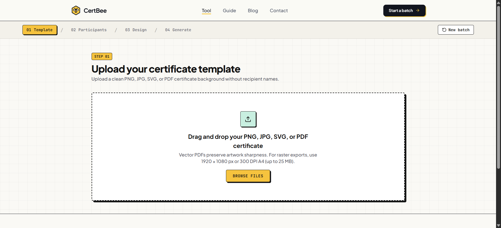
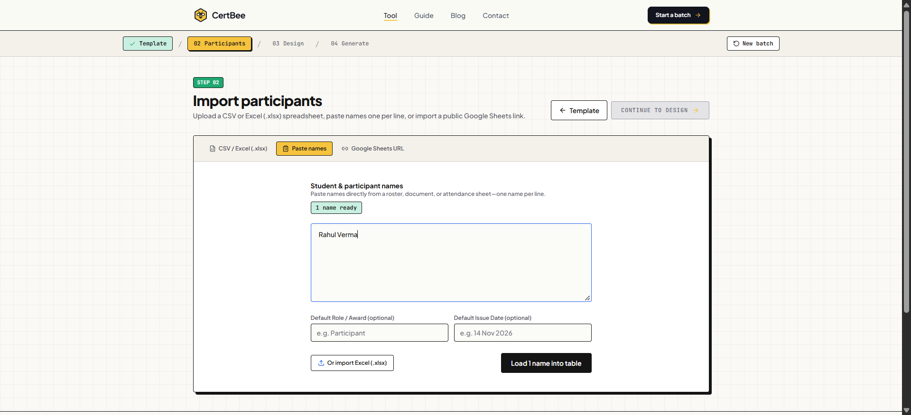
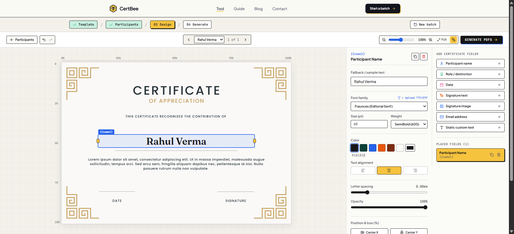
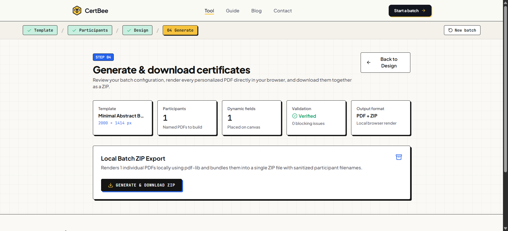

# CertBee

**One design. Every certificate.**

CertBee is a free, browser-native bulk certificate generator built by a Google Student Ambassador for ambassador programs, student clubs, workshops, and campus hackathons. Upload a blank certificate template once, load a participant list, position dynamic text or signature fields visually on a live canvas, and export personalized PDFs bundled as a ZIP—directly in your browser with zero server uploads.

---

## Features

- **Bring Your Own Template**: Drag and drop or browse `PNG`, `JPG`, `SVG`, or vector `PDF` templates (up to 25 MB; recommended `1920 × 1080 px` for digital exports or `3508 × 2480 px` for 300 DPI A4). Vector PDF backgrounds preserve crisp artwork sharpness.
- **Flexible Participant Import**:
  - Upload `.csv`, `.xlsx`, or `.xls` spreadsheets (parsed locally via PapaParse and SheetJS).
  - Paste plain-text names (one per line) with optional default role/award and issue date.
  - Load a public Google Sheets link (`Anyone with the link can view`) directly from the browser via Google's public CSV export endpoint.
  - Edit rows, verify column mapping, and fix data inline before designing.
- **Interactive Certificate Designer**:
  - Place and resize dynamic fields: **Participant name**, **Role / distinction**, **Date**, **Signature text**, **Signature image**, **Email address**, and **Static custom text**.
  - Typography controls with built-in fonts (`Fraunces`, `Playfair Display`, `JetBrains Mono`, `Plus Jakarta Sans`, `Great Vibes`) or custom `.ttf` / `.otf` uploads.
  - Supports **Auto-fit** scaling for long names, alignment, letter spacing, opacity, percentage-based center/coordinate controls, undo/redo history, zoom/fit controls, and live participant switching.
  - Vector PDF font embedding via `pdf-lib` and `@pdf-lib/fontkit`, including support for non-ASCII / Indic scripts (such as Hindi Devanagari and Telugu).
- **Local Batch Export**:
  - Validates rows and generates personalized PDFs (`Certificate_<Name>.pdf`) in browser memory.
  - Download individual certificates or export the full batch as `certificates_batch.zip` via `JSZip`.
  - Recommended batch size: up to ~200–300 PDFs per batch depending on device memory and template file size.
- **Local Draft Persistence & Privacy**:
  - Uploaded templates, spreadsheets, signature assets, custom fonts, and generated PDFs stay on your device—never sent to a backend server.
  - Active batch drafts persist in browser `IndexedDB` so page refreshes do not lose your layout, and can be cleared anytime with **New batch**.

---

## 4-Step Workflow

1. **01 Template** — Upload a clean PNG, JPG, SVG, or PDF certificate background without recipient names.
   

2. **02 Participants** — Import a CSV/Excel spreadsheet, paste names line by line, or load a public Google Sheets link.
   

3. **03 Design** — Place dynamic placeholders on the canvas, customize typography or custom fonts, upload signature artwork, and preview real participant rows live.
   

4. **04 Generate** — Validate the batch, render personalized PDFs locally, and download single files or `certificates_batch.zip`.
   

---

## Tech Stack

- **Framework**: React 19, TypeScript, Vite 8
- **Styling & Motion**: Tailwind CSS v4 (`@tailwindcss/vite`), GSAP + ScrollTrigger, CSS Grid & hardware-accelerated transitions, Lucide icons
- **PDF & Vector Rendering**: `pdf-lib`, `@pdf-lib/fontkit`, `pdfjs-dist`
- **Data Parsing & Packaging**: `papaparse` (CSV), `xlsx` (Excel), `jszip` (ZIP export)
- **Testing**: Vitest

---

## Getting Started

### Prerequisites

- Node.js 20+ and `npm`

### Local Development

```bash
# Install dependencies
npm install

# Start the development server on http://localhost:3000
npm run dev
```

### Scripts

| Command | Description |
| :--- | :--- |
| `npm run dev` | Starts the Vite dev server on port `3000` (`--host=0.0.0.0`) |
| `npm run build` | Builds the production bundle into `dist/` |
| `npm run preview` | Previews the production build locally |
| `npm run lint` | Runs TypeScript type-checking (`tsc --noEmit`) |
| `npm test` | Runs the Vitest unit test suite (`vitest run`) |
| `npm run clean` | Removes `dist/` |

---

## Project Structure

```text
├── index.html                   # App metadata & Google Fonts links
├── vite.config.ts               # Vite configuration & React dedupe
├── public/                      # Static assets & favicon
└── src/
    ├── App.tsx                  # Route shell & legal/error views
    ├── index.css                # Tailwind v4 theme & drafting-paper surface styles
    ├── main.tsx                 # React entry point
    ├── components/              # Navbar, Hero, WorkflowSection, FAQ, Footer, UploadZone, ParticipantTable, FieldToolbar, FieldProperties, GenerationProgress, CertificateCanvas
    ├── editor/                  # Interactive canvas, draggable/resizable field boxes, editor toolbar
    ├── hooks/                   # useBatchWorkspace, useCertificate, useEditor, useParticipants, usePageReveal
    ├── pages/                   # Home, CreateBatch, Guide, Blog, About, Contact
    ├── services/                # Client-side pdfService, zipService, csvService, excelService, sheetsService, storageService
    ├── types/                   # TypeScript interfaces for templates, participants, and editor fields
    └── utils/                   # Coordinate math, font helpers, file validation, sample data
```

---

## Testing

Unit tests cover CSV parsing, PDF rendering helpers, coordinate transformations, and input/URL validation:

```bash
npm test
```

Test suites:
- `src/services/csvService.test.ts`
- `src/services/pdfService.test.ts`
- `src/utils/coordinateUtils.test.ts`
- `src/utils/validation.test.ts`

---

## Contact

Questions, template edge cases, or feedback? Reach out at **sarathkumar86518@gmail.com**.
